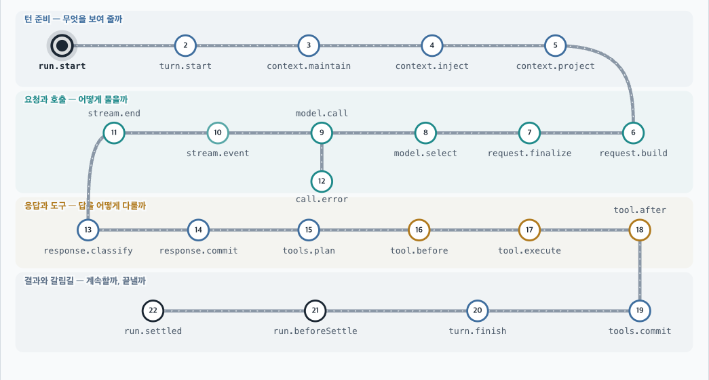
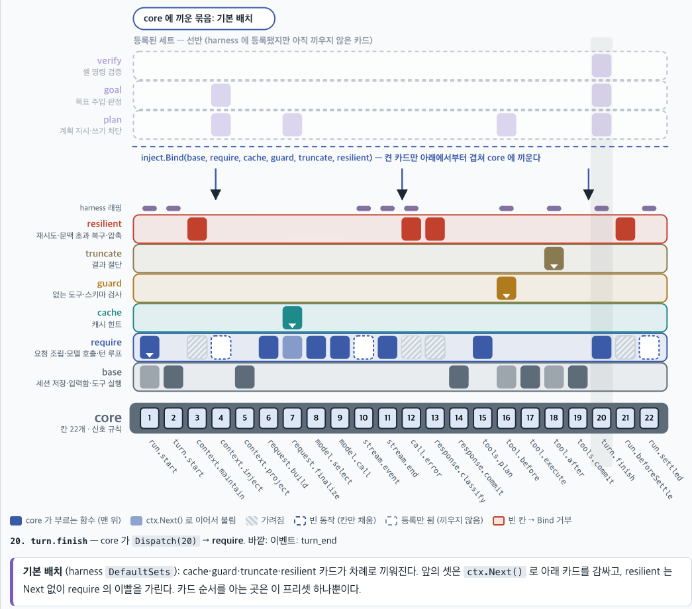

# dynamic_react


**루프는 고정하고, 모든 동작은 밖에서 주입하는 AI 코딩 에이전트 코어입니다.** Go로 작성했습니다.

루프는 정해진 22개 step을 순서대로 지나가기만 합니다. 컨텍스트 구성, 요청 조립, 모델 호출, 도구 실행, 재시도, 압축, 승인 같은 동작은 모두 루프 밖의 함수 세트가 맡습니다. 그래서 루프 코드를 고치지 않고도 에이전트의 동작을 바꿀 수 있습니다.


> 테스트가 실패하는 Go 패키지에서 대화형 CLI `dr` 을 실행한 화면입니다. 에이전트는 테스트를 실행하고, 파일을 읽고, 코드를 고친 뒤, 테스트를 다시 실행해서 결과를 확인합니다. 녹화 방법은 [`docs/demo`](docs/demo/README.md)에 있습니다.

## 목차

- [만든 이유](#만든-이유)
- [핵심 아이디어](#핵심-아이디어)
- [아키텍처](#아키텍처)
- [빠른 시작](#빠른-시작)
- [사용법](#사용법)
- [동작 주입](#동작-주입)
- [모드](#모드)
- [설계 결정](#설계-결정)
- [품질](#품질)
- [개발 과정](#개발-과정)
- [문서 안내](#문서-안내)

## 만든 이유

코딩 에이전트는 대부분 "모델 호출 → 도구 실행 → 다시 모델 호출"을 반복하는 루프입니다. 그런데 이 루프 안에는 정책이 많이 섞여 있습니다. 컨텍스트가 넘치면 언제 압축할지, 요청이 실패하면 몇 번 재시도할지, 어떤 도구를 실행하기 전에 사용자에게 물을지가 그런 정책입니다. 정책이 루프 코드 안에 있으면, 정책 하나를 바꾸려 해도 루프를 고쳐야 합니다.

이 프로젝트는 Hermes, pi, oh-my-pi 세 에이전트의 루프를 비교 분석하는 데서 출발했습니다. 그리고 아래 질문에 답하려고 했습니다.

> 루프에서 정책을 모두 빼내고, 루프는 순서와 전이 규칙만 가지게 할 수 있는가? 그렇게 해도 기존 에이전트의 기능을 모두 표현할 수 있는가?

세 에이전트의 기능 28개를 step과 신호만으로 표현할 수 있는지 하나씩 대조했습니다([대조표](docs/history/VERIFY-22step.md)). 24개는 그대로 표현할 수 있었고, 나머지 4개는 함수 작성 규약을 지키면 표현할 수 있었습니다. 표현할 수 없는 기능은 없었습니다. 그다음에 이 구조 위에서 실제로 동작하는 터미널 에이전트를 만들었습니다.

## 핵심 아이디어

### 1. 루프는 22개 step과 전이 표뿐입니다



core는 위 순서로 step을 진행합니다. 각 step에서 core는 주입된 함수를 하나 부르고, 그 함수가 돌려준 **신호**를 보고 다음 step을 정합니다. core는 함수의 결과 내용을 해석하지 않습니다.

| 신호 종류 | 신호 | 예 |
|---|---|---|
| 전이 (10종) | `next` `recall` `reselect` `rebuild` `restart_turn` `continue_turn` `skip_tools` `settle` `stop` `fail` | 컨텍스트가 넘치면 `[rewrite(압축), rebuild]` 를 돌려서 투영부터 다시 합니다 |
| 효과 (3종) | `rewrite` `inject_input` `start_tool` | 스트리밍 중에 `start_tool` 로 도구를 미리 실행합니다 |

step마다 쓸 수 있는 신호와 조회가 정해져 있습니다. 허용되지 않은 신호를 쓰면 **컴파일 에러**가 납니다. step마다 다른 ctx 타입을 코드 생성기로 만들고, 봉인된 interface로 막았기 때문입니다.

### 2. 동작은 함수 세트를 층으로 쌓아서 만듭니다



함수 세트(`inject.FunctionSet`)는 22개 step 중 자기가 맡을 칸에만 함수를 가진 카드입니다. 세트를 여러 장 겹치면 위 세트가 먼저 불리고, `ctx.Next()` 로 아래 세트를 부를 수 있습니다. 기본 배치는 아래와 같습니다.

| 세트 | 하는 일 |
|---|---|
| `base` | 세션 저장, 입력함, 도구 실행 |
| `require` | 요청 조립, 모델 호출, 턴 루프 |
| `cache` | 프롬프트 캐시 지점 지정 |
| `guard` | 없는 도구와 스키마 위반 검사 |
| `truncate` | 긴 도구 결과 자르기 |
| `resilient` | 재시도, 문맥 초과 복구, 압축 |

세트는 실행 중에도 켜고 끄거나 순서를 바꿀 수 있습니다. 바뀐 배치는 다음 run부터 적용됩니다. 인터랙티브 그림은 [`docs/architecture.html`](docs/architecture.html)을 브라우저로 열어서 볼 수 있습니다.

## 아키텍처

```text
 L3_ui       입출력: 터미널, 스트림 표시, 신호, 종료 코드
             surfaces/terminal  대화형 터미널 라이브러리
             cmd/dr             대화형 진입점
             cmd/dr-print       비대화형 CLI
 ─────────────────────────────────────────────────────────────
 L2_harness  사용자 환경 위의 실제 에이전트
             harness   Env + ModelCaller 위에서 에이전트 조립:
                       도구 로직, JSONL 세션, 프롬프트, 요약기, 모드
             osenv     Env 의 OS 구현: 파일, 셸, 프로세스 그룹
             agent     설정 + 키 파일 + osenv + adapters → 완성된 에이전트
 ─────────────────────────────────────────────────────────────
 L1_inject   사용자가 고치는 층
             inject    함수 interface, step 별 ctx, 층 바인딩(ctx.Next), 조합 함수
             sets      기본 함수 세트, 보조 모델 통로, 모드 interface
             adapters  모델 방언: Anthropic, OpenAI Chat, OpenAI Responses
 ─────────────────────────────────────────────────────────────
 L0_core     core
             core      루프: 22개 step, 전이, 신호, 스트림·도구 동시 실행
             contract  공유 데이터 타입
```

```text
 contract ◄── core ◄── inject
    ▲                     ▲
    └── adapters          │
           ▲              │
           └── agent ──► harness ──► sets ──► inject, core, contract
                 ▲  └──► osenv ──► harness/env
                 ├── dr-print (L3)
                 ├── examples/inject, examples/verify, examples/modes
                 └── terminal (L3) ◄── dr (L3)
```

- 의존은 위 층에서 아래 층으로만 향합니다.
- L0과 L1은 파일이나 셸 같은 사용자 환경을 모르는 라이브러리입니다. 사용자 환경은 L2부터 다룹니다.
- `L0_core/core` 와 `L1_inject/adapters` 는 `contract` 와 표준 라이브러리만 씁니다. 외부 의존은 `golang.org/x/text`·`x/term`·`x/sys` 뿐입니다.
- 폴더마다 독립된 Go 모듈입니다(모듈 14개). 경로는 `github.com/Biisairo/dynamic_react/<폴더>` 이고, 개발할 때는 루트의 `go.work` 로 묶습니다.
- 어느 층도 환경변수를 읽지 않습니다. 모든 값은 설정 파일에서 옵니다.

## 빠른 시작

Go 1.23 이상이 필요합니다.

```sh
git clone https://github.com/Biisairo/dynamic_react.git
cd dynamic_react
go build -o bin/ ./L3_ui/cmd/dr ./L3_ui/cmd/dr-print

./bin/dr                      # 대화형 (터미널 필요)
./bin/dr-print "질문"          # 비대화형 (stdin 도 받음, -json 은 이벤트를 JSON 줄로 출력)
```

처음 실행하면 모델이 설정되어 있지 않아서 모델 선택 화면이 뜹니다. 키가 필요한 provider는 `/login <provider>` 로 API 키를 넣어야 목록에 나옵니다. 고른 모델은 설정 파일에 저장됩니다.

인증은 API 키만 지원합니다. 구독 계정(Claude Pro/Max, ChatGPT 플랜)의 로그인이나 OAuth 경로는 일부러 넣지 않았습니다.

## 사용법

### `dr` 옵션과 명령

- 옵션: `-model provider/id`(이번 실행에만 적용, 저장하지 않음), `-cwd`, `-config`, `-session <id>`, `-c`(최근 세션), `-r`(세션 목록에서 고르기), `-no-color`
- 명령: `/model [provider/id]`, `/login [provider]`, `/logout [provider]`, `/sets`, `/set <name> on|off|to <n>`, `/modes`, `/mode <name> [arg]`, `/mode off`, `/status`, `/sessions`, `/resume [번호|id]`, `/new`, `/compact`, `/help`, `/quit`
- 키: Enter는 전송(실행 중에는 steer), Alt+Enter는 follow-up, Shift+Enter와 Ctrl+J는 줄바꿈, Esc와 Ctrl+C는 실행 중단입니다.

### 설정 파일

| 파일 | 내용 |
|---|---|
| `~/.dynamic_react/config.json` | 사용자 설정입니다. `sessionDir`, `shellPath`(기본 `/bin/bash`), `agent`(모델, thinking, tools, compaction, retry), `providers`, `models`, `permissions`, `sets`(세트 배치, `/set` 이 씁니다)를 둡니다. 키 필드는 없습니다. |
| `~/.dynamic_react/auth.json` | API 키를 둡니다(`{"<provider>": {"type": "api_key", "key": "…"}}`, 권한 0600). `/login` 이 씁니다. 저장소에 넣지 마십시오. |
| `~/.dynamic_react/sessions/` | 세션 JSONL 파일의 기본 위치입니다. |
| `<cwd>/.dynamic_react/config.json` | 프로젝트 설정입니다. `permissions` 만 둘 수 있습니다. |

```json
{
  "agent": {"model": {"provider": "deepseek", "id": "deepseek-flash"}, "thinking": "medium"},
  "providers": {"mine": {"api": "openai-chat", "baseUrl": "http://localhost:8000/v1"}},
  "models": {"mine/qwen": {"contextWindow": 32768}},
  "permissions": {"allow": ["read", "bash(go test *)"], "ask": ["bash(git push *)"]}
}
```

승인 규칙의 우선순위는 deny > ask > allow 순서이고, 맞는 규칙이 없으면 사용자에게 묻습니다. 작업 폴더의 `AGENTS.md`·`CLAUDE.md` 는 시스템 프롬프트에 프로젝트 지침으로 들어갑니다.

## 동작 주입

core(22개 step 루프)를 뺀 모든 것은 `agent.New` 를 부를 때 Go 함수로 바꿀 수 있습니다. 각 함수는 기본값을 받아서 바꾼 값을 돌려줍니다. 필드가 nil이면 기본값을 그대로 씁니다.

| 필드 | 바꾸는 것 |
|---|---|
| `Sets func(sets.Deps) []harness.SetEntry` | 등록할 함수 세트 목록과 기본 켜짐 상태입니다. 기본값은 `harness.DefaultSets(d)` 입니다. 목록에서 뒤에 있는 세트가 위 층입니다. |
| `ToolSet func([]sets.Tool) []sets.Tool` | 도구 목록입니다. 도구를 추가하거나, 빼거나, 같은 이름으로 바꿀 수 있습니다. |
| `System func([]contract.Block) []contract.Block` | 시스템 프롬프트입니다. |
| `Summarizer func(sets.Summarizer) sets.Summarizer` | 요약기입니다. nil을 돌려주면 압축을 끕니다. |
| `Store func(harness.Store) harness.Store` | 세션 저장소입니다. 세션 목록과 이력도 이 저장소를 씁니다. |
| `ModelCaller func(sets.ModelCaller) sets.ModelCaller` | 모델 호출입니다. 모델 목록과 키 확인은 adapters가 그대로 맡습니다. |

아래 예시는 매 턴 규칙 메시지를 덧붙이고, 위험한 도구 호출을 막는 세트를 기본 배치 위에 얹습니다.

```go
a, err := agent.New(ctx, agent.Options{
    Sets: func(d sets.Deps) []harness.SetEntry {
        mine := inject.FunctionSet{Name: "mine",
            ContextInject: func(ctx *inject.ContextInjectCtx) ([]contract.Message, []inject.ContextInjectSignal, error) {
                return []contract.Message{rule()}, nil, nil // 이번 턴의 요청에만 들어가고 저장되지 않는다
            },
            ToolBefore: func(ctx *inject.ToolBeforeCtx, c contract.ToolCall) (core.BeforeOut, []inject.ToolBeforeSignal, error) {
                if blocked(c) {
                    return core.BeforeOut{Call: c, ShortCircuit: &contract.ToolResult{CallID: c.ID, Status: contract.StatusError}}, nil, nil
                }
                return ctx.Next(c) // 아래 층(guard → base)을 부르면 기본 검사가 남는다
            }}
        return append(harness.DefaultSets(d), harness.SetEntry{Set: mine, On: true}) // 뒤의 세트가 위 층
    },
})
```

- 승인 규칙, Approver, 이벤트는 사용자가 세트를 어떻게 배치해도 유지됩니다. 기본 검사는 `guard` 세트가 합니다. `guard` 를 끄거나, `ctx.Next` 를 부르지 않고 덮으면 기본 검사가 빠집니다. 이 경우의 책임은 사용자에게 있습니다.
- 실행 중에는 `dr` 의 `/sets` 로 배치를 보고, `/set guard off`·`/set guard to 1` 로 켜기, 끄기, 순서를 바꿉니다. 바뀐 배치는 다음 run부터 적용되고 설정의 `sets` 에 저장됩니다. 빈 step이 생기는 배치(예: `/set require off`)는 거부됩니다. Go 코드에서는 `Agent.Sets()`·`ArrangeSets` 를 씁니다.
- 추가한 도구도 도구 상한, 설정 `agent.tools`, 이름 규칙의 적용을 받습니다. 패턴 규칙은 `bash`·`read`·`write`·`edit`·`grep`·`find`·`ls` 에만 쓸 수 있습니다.
- 실행할 수 있는 예시가 세 개 있습니다.
  - [`examples/inject`](examples/inject/main.go): 규칙 덧붙이기와 `rm -rf` 차단 (`cd examples/inject && go run . "질문"`)
  - [`examples/verify`](examples/verify/main.go): 변경한 뒤 셸 명령으로 스스로 검증하고, 실패하면 출력을 모델에 돌려줍니다 (`go run . -check "go test ./..." "질문"`)
  - [`examples/modes`](examples/modes/main.go): goal 모드와 plan 모드 (아래 [모드](#모드))
- 세트를 만드는 순서, 세트 이름과 상태, 저장소 계약, 사용자 책임은 [`docs/INJECT.md`](docs/INJECT.md)에 자세히 있습니다.

## 모드

세션마다 모드를 두고, 모드에 따라 세트 배치를 **턴 경계에서** 바꿉니다. 모드는 "기본 배치 위에 쌓을 세트(`Push`)"와 "끌 세트(`Off`)"로 정의하고, `agent.Options.Modes` 로 등록합니다.

- 진입: 사용자가 `/mode <name> [arg]`(Go에서는 `EnterMode`)로 들어가거나, 모델이 `mode` 도구로 들어갑니다. 모델은 기본 모드이고 예약된 전환이 없을 때만 들어갈 수 있습니다.
- 이탈: 모드의 세트(`sets.ModesOf(d).Exit`)나 사용자(`/mode off`)가 나갑니다. 모델은 모드에서 나갈 수 없습니다.
- 적용 시점: run 안에서 바꾸면 다음 `turn.start` 에, run 밖에서 예약하면 다음 run 시작에 적용됩니다. 모드는 세션 상태(`harness.mode`)에 저장되어서 세션을 다시 열어도 유지됩니다.
- 판단기 같은 세트는 `sets.AuxOf(d).Complete(ctx, config, role, system, msgs)` 로 보조 모델을 부릅니다. 보조 모델의 모델, max tokens, thinking은 설정 `agent.aux.<role>` 로 정하고, 없으면 본 모델을 씁니다. run 밖에서는 `Agent.Complete` 를 씁니다.
- 예시 [`examples/modes`](examples/modes/main.go)에는 goal 모드(품질 게이트를 통과할 때까지 보조 모델이 판정)와 plan 모드(쓰기 도구 차단)가 있습니다 (`cd examples/modes && go run . [-check "go test ./..."]`).
- 자세한 사용법은 [`docs/INJECT.md`](docs/INJECT.md) 5장에 있습니다. run이 끝난 뒤 다음 run을 언제 시작할지 정하는 대기 제어(자동 재개, 주기 실행)는 범위에서 뺐습니다.

## 설계 결정

결정 58개는 모두 [`docs/DECISIONS.md`](docs/DECISIONS.md)에 근거와 함께 남겼습니다. 아래는 구조를 정한 주요 결정입니다.

| 결정 | 이유 |
|---|---|
| 루프에는 step 순서와 전이 표만 두고 정책은 하나도 두지 않습니다 (D1) | 정책을 바꿀 때 루프를 고치지 않게 하려는 것이 이 프로젝트의 목적입니다. |
| `turn.finish` 같은 분기 step에서는 `next` 를 허용하지 않습니다 (R2) | "도구를 실행했으면 계속한다" 같은 기본 동작이 루프 안의 암묵적 정책이 되는 것을 막습니다. 함수가 다음 행동을 직접 밝혀야 합니다. |
| step마다 ctx를 새로 만들고, 허용된 신호와 조회만 타입으로 노출합니다 (D4) | 잘못된 신호를 런타임이 아니라 컴파일 단계에서 막습니다. step 22개 × 신호 13개의 허용 표를 코드 생성기로 타입에 옮겼습니다. |
| step 하나에 함수는 하나만 두고, 여러 기능은 `ctx.Next` 층으로 조합합니다 (D5) | 루프에 우선순위 표가 생기지 않습니다. 충돌은 세트를 쌓는 순서로만 결정됩니다. |
| 서드파티 확장도 같은 프로세스의 Go `FunctionSet` 으로 만듭니다 (D12) | 처음에는 별도 프로세스와 gRPC를 검토했습니다. 런타임 격리는 목표가 아니어서 단순한 쪽을 택했습니다. |
| 폴더마다 독립 모듈로 나눕니다 (R8, R9) | 레이어 의존 방향을 `go.mod` 수준에서 드러냅니다. core의 `go.mod` 에는 `contract` 만 있어서, core가 위 층을 import하면 `GOWORK=off` 빌드와 `go mod tidy` 검사가 실패합니다. |
| 환경변수를 읽지 않고, 키는 `auth.json`(0600)에만 둡니다 (R21) | 설정 출처를 하나로 모아서 동작을 재현할 수 있게 합니다. |

## 품질

| 항목 | 값 |
|---|---|
| Go 모듈 | 14개 |
| 코드 | 제품 코드 약 20,200줄, 테스트 코드 약 20,700줄 |
| 테스트 함수 | 576개 |
| 검증 | 모든 모듈에서 `gofmt`, `go vet`, `go test -race`, `GOWORK=off go mod tidy -diff`, `golangci-lint` 를 통과합니다 (2026-10-16 로컬 검증) |

모듈별 문장(statement) 커버리지입니다. 2026-10-16에 `go test -cover` 로 측정했습니다.

| 모듈 | 커버리지 | 모듈 | 커버리지 |
|---|---|---|---|
| `L0_core/contract` | 97.3% | `L2_harness/osenv` | 90.3% |
| `L0_core/core` | 97.7% | `L2_harness/agent` | 95.2% |
| `L1_inject/inject` | 93.3%* | `L3_ui/surfaces/terminal` | 96.9% |
| `L1_inject/sets` | 92.2% | `L3_ui/cmd/dr` | 85.2% |
| `L1_inject/adapters` | 92.6% | `L3_ui/cmd/dr-print` | 90.0% |
| `L2_harness/harness` | 97.5% | | |

\* 코드 생성기가 만든 `zz_generated.go` 를 뺀 값입니다. 생성 코드를 포함하면 59.4%입니다.

## 개발 과정

2026-09-30부터 2026-10-12까지 개발했고, 개발을 마칠 때까지 커밋은 80개였습니다. 모든 기능은 같은 순서로 만들었습니다.

1. 결정 기록(`docs/DECISIONS.md`)에 방향을 적습니다.
2. 모듈의 `SPEC.md` 에 요구사항을 IEEE 29148 형식으로 씁니다. 스펙은 14개, 약 3,700줄입니다.
3. 스펙의 검증 표대로 테스트를 먼저 쓰고, 실패하는 것을 확인합니다.
4. 구현해서 테스트를 통과시킵니다.
5. 스펙과 코드가 충돌하면 구현을 멈추고 스펙을 먼저 고칩니다.

세션이 끝날 때마다 다음 세션에 넘길 인계 문서를 남겼습니다. 인계 문서 12개와 개선 목록은 [`docs/history`](docs/history/README.md)에 있습니다.

## 문서 안내

| 위치 | 내용 |
|---|---|
| [`L0_core/contract`](L0_core/contract/SPEC.md) | 공유 데이터 계약 (스펙 v0.5) |
| [`L0_core/core`](L0_core/core/SPEC.md) | 루프 본체 (스펙 v0.2) |
| [`L1_inject/inject`](L1_inject/inject/SPEC.md) | 함수 주입 프레임워크, 층 바인딩, 조합 함수, 공유 run 표 (스펙 v0.5) |
| [`L1_inject/sets`](L1_inject/sets/SPEC.md) | 함수 세트, 보조 모델 통로, 모드 interface, 캐시 지점 (스펙 v0.13) |
| [`L1_inject/adapters`](L1_inject/adapters/SPEC.md) | 모델 방언 어댑터, provider 프로필, 모델 카탈로그 (스펙 v0.8) |
| [`L2_harness/harness`](L2_harness/SPEC.md) | 에이전트 조립: 도구 7종, 세션 형식, 프롬프트, 요약기, 세트 배치, 세션 모드, 캐시 접두 감지 (스펙 v1.11) |
| [`L2_harness/osenv`](L2_harness/osenv/SPEC.md) | Env의 OS 구현 (스펙 v0.3) |
| [`L2_harness/agent`](L2_harness/agent/SPEC.md) | 완성된 에이전트와 surface 공통 계층: 승인, steer, follow-up, 세션, 모델 선택, 키, 모드 (스펙 v0.11) |
| [`L3_ui/surfaces/terminal`](L3_ui/surfaces/terminal/SPEC.md) | 대화형 터미널 라이브러리 (스펙 v0.10) |
| [`L3_ui/cmd/dr`](L3_ui/cmd/dr/SPEC.md) | 대화형 진입점 (스펙 v0.3) |
| [`L3_ui/cmd/dr-print`](L3_ui/cmd/dr-print/SPEC.md) | 비대화형 CLI (스펙 v0.2) |
| [`examples/inject`](examples/inject/SPEC.md)·[`verify`](examples/verify/SPEC.md)·[`modes`](examples/modes/SPEC.md) | 주입 예시 (스펙 v0.2·v0.3·v0.4) |
| [`docs/DECISIONS.md`](docs/DECISIONS.md) | 결정 기록 |
| [`docs/INJECT.md`](docs/INJECT.md) | 주입 가이드 |
| [`docs/architecture.html`](docs/architecture.html) | 인터랙티브 구조 그림 (브라우저로 엽니다) |
| [`docs/history`](docs/history/README.md) | 인계 문서, 개선 목록, 22 step 대조표 |

## 상태

이 프로젝트는 2026-10-12에 개발을 마쳤습니다. 목적은 "루프는 고정하고, 모든 동작은 세트로 주입한다"는 구조를 증명하는 것이었고, 그 목적을 달성했습니다([목표 G1~G6](docs/history/GOALS.md)). 남은 항목(세트 후보, 실제 모델 검증, 결정 대기)은 모두 보류 상태이며, 내용은 [`docs/history/GOALS.md`](docs/history/GOALS.md)에 그대로 남아 있습니다.

## 서드파티 고지

pi-mono와 oh-my-pi에서 가져온 문안과 데이터, 외부 Go 의존의 라이선스는 [`THIRD_PARTY_NOTICES.md`](THIRD_PARTY_NOTICES.md)에 있습니다.
